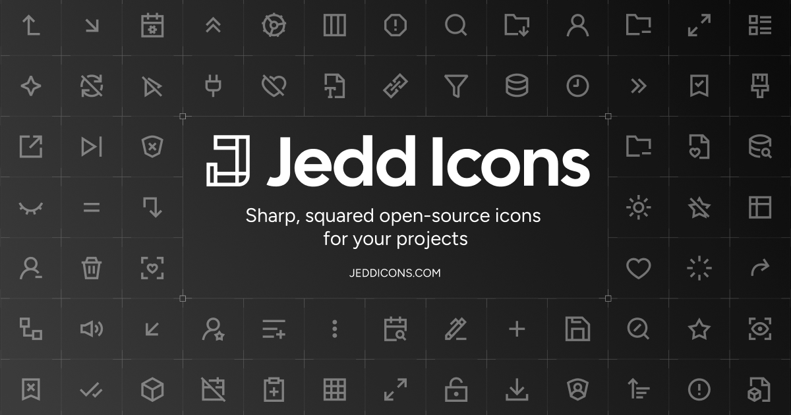

<p align="center">
  <a href="https://jeddicons.com/">
    
  </a>
</p>
<p align="center">
  <a href="https://jeddicons.com/">Icons</a>
  ·
  <a href="https://jeddicons.com/docs">Docs</a>
  ·
  <a href="https://www.npmjs.com/package/@jedd-icons/react">Packages</a>
  ·
  <a href="https://github.com/jedd-labs/jedd-icons/blob/main/LICENSE">License</a>
</p>
<p align="center">
  <a href="https://www.npmjs.com/package/@jedd-icons/react"></a>
  <a href="https://www.npmjs.com/package/@jedd-icons/react"></a>
  <a href="https://github.com/jedd-labs/jedd-icons/actions/workflows/ci.yml"></a>
  <a href="https://github.com/jedd-labs/jedd-icons/blob/main/LICENSE"></a>
</p>

# jedd-icons

Jedd Icons is a sharp, squared icon set for React and vanilla JavaScript. This
monorepo contains the source SVGs, published packages, build tooling, docs site,
and icon-inspection lab.

## Repository

```
icons/                          source-of-truth SVG + JSON pairs
tools/build-icons/              SVG → per-icon TS generator
packages/react/                 the React package (@jedd-icons/react)
packages/core/                  the vanilla JS package (@jedd-icons/core)
packages/shared/                shared types and utilities (@jedd-icons/shared)
packages/ui/                    shared UI components (@workspace/ui)
apps/www-docs/                  gallery / docs site
apps/lab/                       icon inspection and visualization tool
```

## Documentation

- Browse the icons and package guides at [jeddicons.com](https://jeddicons.com/).
- Read the [documentation](https://jeddicons.com/docs) for installation, usage,
  styling, and adding icons.
- See [CONTRIBUTING.md](CONTRIBUTING.md) for local development, quality checks,
  changesets, and the release process.
