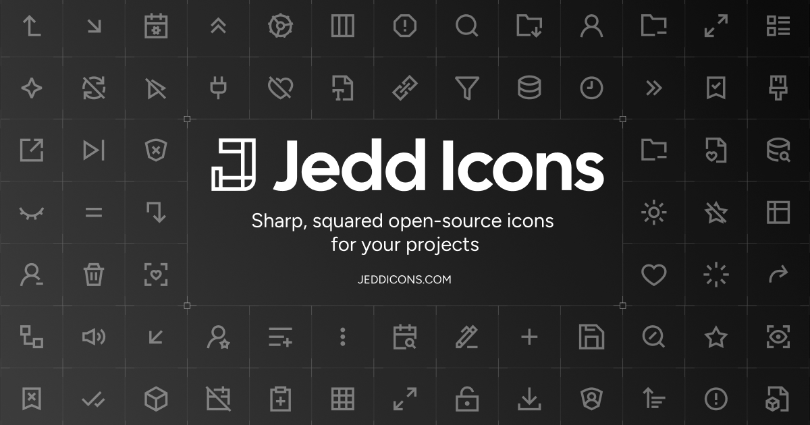

<p align="center">
  <a href="https://jeddicons.com/">
    
  </a>
</p>
<p align="center">
  <a href="https://jeddicons.com/">Icons</a>
  ·
  <a href="https://jeddicons.com/docs">Docs</a>
  ·
  <a href="https://www.npmjs.com/package/@jedd-icons/react">Packages</a>
  ·
  <a href="https://github.com/jedd-labs/jedd-icons/blob/main/LICENSE">License</a>
</p>
<p align="center">
  <a href="https://www.npmjs.com/package/@jedd-icons/react"></a>
  <a href="https://www.npmjs.com/package/@jedd-icons/react"></a>
  <a href="https://github.com/jedd-labs/jedd-icons/actions/workflows/ci.yml"></a>
  <a href="https://github.com/jedd-labs/jedd-icons/blob/main/LICENSE"></a>
</p>

# jedd-icons

A monorepo for building and distributing a set of SVG icons as React components and vanilla JS modules.

```
icons/                          source-of-truth SVG + JSON pairs
tools/build-icons/              SVG → per-icon TS generator
packages/react/                 the React package (@jedd-icons/react)
packages/core/                  the vanilla JS package (@jedd-icons/core)
packages/shared/                shared types and utilities (@jedd-icons/shared)
apps/www-docs/                  gallery / docs site
```

## Adding icons

Drop an SVG, add metadata, run one command.

### 1. Drop the SVG

Save your file at `icons/<name>.svg` using **kebab-case**. Icons must fit inside a 24x24 viewBox and use **strokes only** (no fills on child elements). The canonical root attributes are:

```svg
<svg xmlns="http://www.w3.org/2000/svg" width="24" height="24" viewBox="0 0 24 24"
     fill="none" stroke="currentColor" stroke-width="2"
     stroke-linecap="butt" stroke-linejoin="miter">
  <!-- geometry only: <path>, <circle>, <rect>, <line>, <polygon>, <polyline> -->
</svg>
```

Child elements should only contain geometry attributes (`d`, `cx`, `r`, `points`, etc.) — not presentation attributes like `stroke` or `fill`. These are set on the root `<svg>` and inherited at render time so that `color`, `strokeWidth`, and other props work correctly.

> If your SVGs have inline presentation attributes on child elements (common with design tool exports), `pnpm icons:clean` will strip them automatically and normalize the root attributes.

Design rules:
- Stay inside the 24x24 viewBox with ~1px padding on each side (room for stroke).
- Stroke-only — no `fill` on child elements.
- Keep the geometry flat: no `<g>` groups, no `<defs>`, no `<mask>`. The parser is intentionally simple.
- Keep the parts separate: export each part of the icon (e.g. a bookmark and the check inside it) as its own `<path>`, and don't merge them into one. Keep each continuous stroke in one path, though; splitting it would break its corners. The build merges paths when it generates the packages, so this only affects the source files. Export without layer names (Figma's "Include 'id' attribute" off); `pnpm icons:clean` strips any `id`s anyway.
- Export final coordinates: no rotated shapes (reset the rotation or flatten with ⌘E), no Repeat groups (they export as `<use>`), and no dash patterns (draw dashes as separate strokes). `pnpm icons:check` flags each of these (and `pnpm icons:clean` warns when cleaning drops a group's rotation or a dash pattern).

### 2. Add metadata

Create `icons/<name>.json` next to the SVG:

```json
{
  "$schema": "../icon.schema.json",
  "tags": ["search-keyword-1", "search-keyword-2"],
  "categories": ["shapes"]
}
```

The full set of fields lives in `icon.schema.json` at the repo root. Useful optional fields:

```json
{
  "aliases": [{ "name": "older-name" }],
  "contributors": ["yourname"],
  "deprecated": true,
  "deprecationReason": "Use new-name instead"
}
```

`categories` is an enum — valid values are listed in `icon.schema.json`.

### 3. Build everything

```bash
pnpm icons
```

This single command runs the full pipeline:
1. **`icons:clean`** — normalizes root `<svg>` attributes and strips inline presentation attributes from child elements
2. **`icons:check`** — checks the normalized SVGs and their `.json` metadata without changing them (export problems such as transforms, `<use>` or dots too short for Safari, geometry outside the 1px margin, metadata not matching `icon.schema.json`); stops on errors
3. **`build`** — builds `@jedd-icons/shared`, generates icon TS files, builds `@jedd-icons/core` and `@jedd-icons/react`

### 4. Import it

The icon is exported as a **PascalCase** component derived from its kebab-case filename (`chevron-right.svg` → `ChevronRight`):

```tsx
import { ChevronRight } from "@jedd-icons/react"

<ChevronRight />                                    // 24px, currentColor, stroke 2
<ChevronRight size={32} color="#0f172a" strokeWidth={1.5} />
<ChevronRight size={64} strokeWidth={1.5} absoluteStrokeWidth />  // visually 1.5px at any size
<ChevronRight className="text-blue-500" aria-label="Description" />
```

### 5. Verify in the gallery

```bash
pnpm --filter www-docs dev
```

Open `http://localhost:3000`. Your icon shows up in the grid; the search box filters by name; the sliders demo the consumer-side `size` / `strokeWidth` / `color` / `absoluteStrokeWidth` props live.

## Individual commands

| Command | What it does |
|---|---|
| `pnpm icons` | Full pipeline: clean + check SVGs, then build all packages |
| `pnpm icons:clean` | Normalize source SVGs (strip inline attrs, set root defaults) |
| `pnpm icons:check` | Check source SVGs without changing them; exits 1 on errors |
| `pnpm build` | Build all packages via Turbo |
| `pnpm --filter @jedd-icons/react gen` | Regenerate icon TS files only |
| `pnpm --filter @jedd-icons/react build` | Build the React package |
| `pnpm --filter @jedd-icons/react dev` | Watch & rebuild on changes |
| `pnpm --filter www-docs dev` | Run the gallery/docs site |

## Adding UI components (gallery)

The gallery in `apps/www-docs` uses shadcn/ui components from `@workspace/ui`. To add a new shadcn component:

```bash
pnpm dlx shadcn@latest add button -c apps/www-docs
```

Components land in `packages/ui/src/components/`. Import them with:

```tsx
import { Button } from "@workspace/ui/components/button"
```
